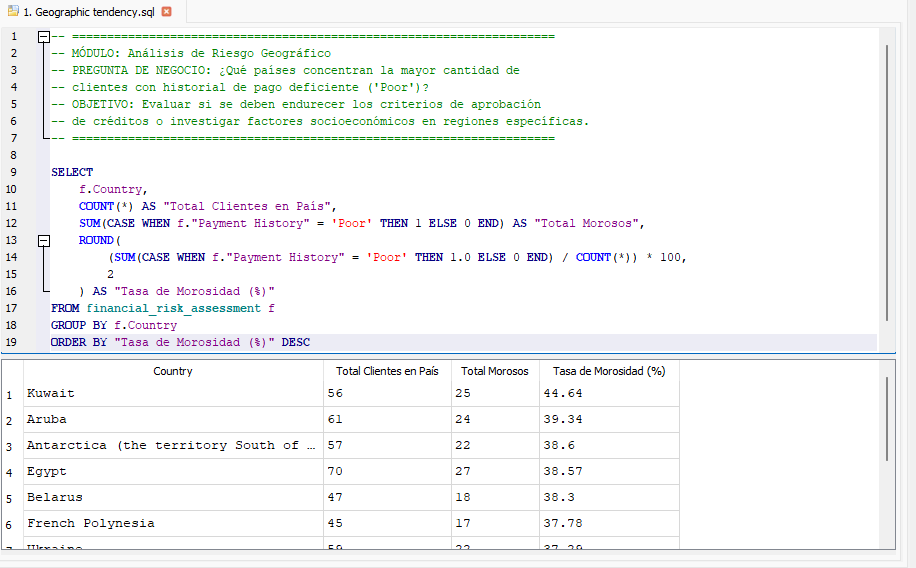
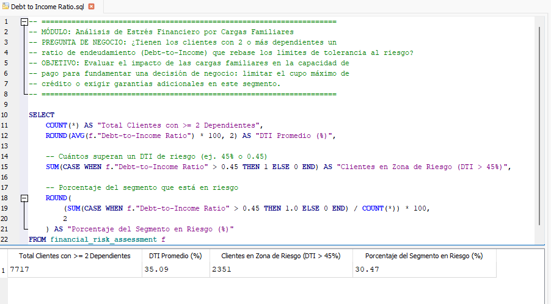
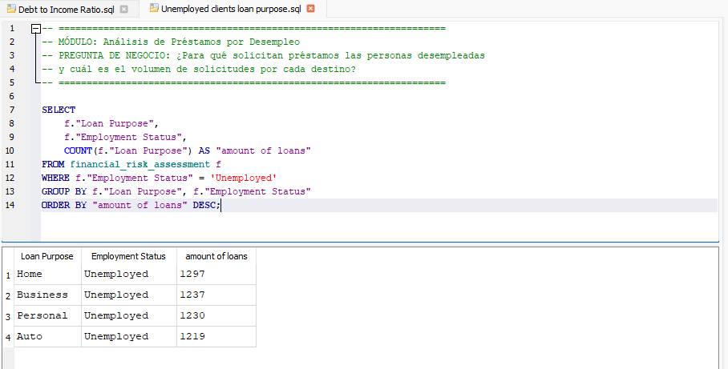
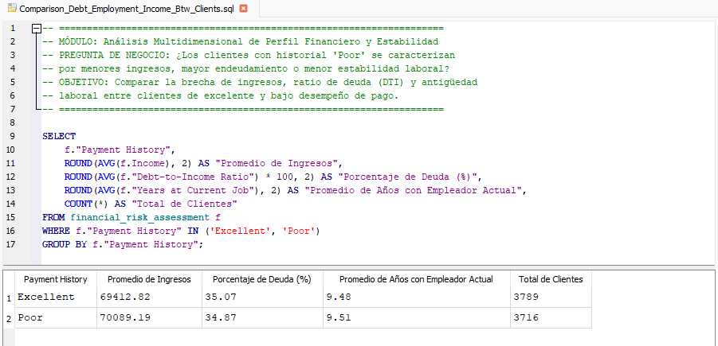
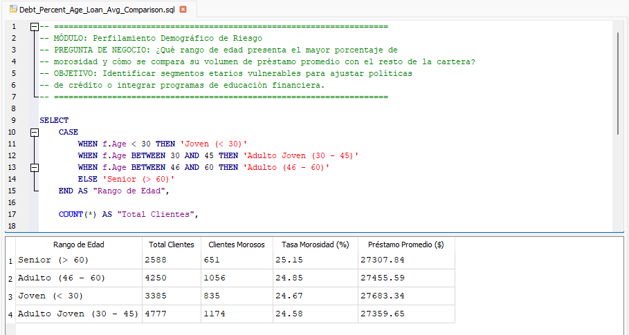
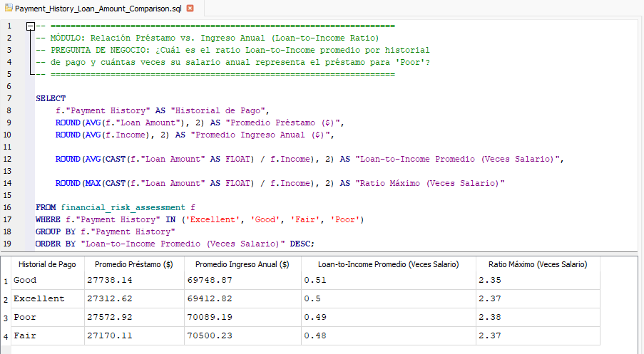

# 📊 Análisis de Riesgo Crediticio y Cartera de Morosidad

## 1. Contexto del Negocio y Objetivo
En el sector de gestión de riesgo financiero, la capacidad de anticiparse a la morosidad y evaluar con precisión el estrés financiero de los clientes es vital para proteger la rentabilidad de la cartera. Este proyecto implementa un análisis exploratorio y de segmentación utilizando **SQL (SQLite)** para auditar el comportamiento de pago, la carga de endeudamiento, el perfil demográfico y el riesgo territorial de los clientes.

---

## 2. Estructura del Repositorio
* `sql/script_analisis_riesgo.sql`: Archivo consolidado con los 6 módulos de consultas SQL.
* `assets/screenshots/`: Capturas de pantalla de la ejecución de cada consulta en DB Browser.
* `dataset/`: Archivo de datos base utilizado para las auditorías.

---

## 3. Hallazgos por Módulo de Análisis

### Módulo 1: Riesgo Territorial y Geográfico
* **Pregunta de Negocio:** ¿Qué países concentran la mayor tasa de clientes con historial de pago deficiente ('Poor')?

* **Hallazgo:** El análisis geográfico revela que Kuwait presenta la tasa de morosidad más alta de la cartera con un 44.64%, superando por más de 5 puntos porcentuales al segundo país con mayor riesgo (Aruba, con 39.34%). Este comportamiento se repite de forma crítica en el resto del Top 10 de regiones evaluadas.

* **Recomendación de Negocio:** Establecer un objetivo preventivo de negocio consistente en incrementar los requerimientos y filtros de aprobación crediticia para estas regiones específicas, mitigando así el riesgo de que la tasa de morosidad continúe escalando.
* **Captura de Resultado:**
  

### Módulo 2: Estrés Financiero por Cargas Familiares
* **Pregunta de Negocio:** ¿Tienen los clientes con 2 o más dependientes un ratio de endeudamiento (Debt-to-Income) que rebase los límites de tolerancia al riesgo?
* **Hallazgo:** *Dentro del universo de 7,717 clientes con 2 o más dependientes, el 30.47% (2,351 clientes) se encuentra en una zona de alto riesgo financiero al superar un DTI del 45%. Aunque el DTI promedio del segmento se sitúa en un 35.09%, casi un tercio de este grupo compromete de forma crítica su liquidez mensual para cumplir con sus obligaciones.*

* **Recomendación de Negocio:** Para mitigar el sobreendeudamiento en hogares vulnerables, se sugiere implementar una política de cap máximo de DTI al 40% para solicitudes con 2+ dependientes, además de ajustar el cupo de crédito aprobado o solicitar garantías adicionales en aquellos casos que sobrepasen el umbral de tolerancia.
* **Captura de Resultado:**
  

### Módulo 3: Riesgo Operativo por Desempleo
* **Pregunta de Negocio:** ¿Para qué solicitan préstamos las personas desempleadas y cuál es el volumen de solicitudes por cada destino?
* **Hallazgo:** *(Inserta aquí tu hallazgo).*
* **Captura de Resultado:**
  

### Módulo 4: Análisis Multidimensional de Perfil Financiero
* **Pregunta de Negocio:** ¿Los clientes con historial 'Poor' se caracterizan por menores ingresos, mayor endeudamiento o menor estabilidad laboral?
* **Hallazgo:** *(Inserta aquí tu hallazgo).*
* **Captura de Resultado:**
  

### Módulo 5: Perfilamiento Demográfico de Riesgo
* **Pregunta de Negocio:** ¿Qué rango de edad presenta el mayor porcentaje de morosidad y cómo se compara su volumen de préstamo promedio?
* **Hallazgo:** *(Inserta aquí tu hallazgo).*
* **Captura de Resultado:**
  

### Módulo 6: Apalancamiento e Ingreso (Loan-to-Income Ratio)
* **Pregunta de Negocio:** ¿Cuál es el ratio Loan-to-Income promedio por historial de pago y cuántas veces su salario anual representa el préstamo para 'Poor'?
* **Hallazgo:** *(Inserta aquí tu hallazgo).*
* **Captura de Resultado:**
  

---

## 💡 4. Conclusiones y Recomendaciones Estratégicas

1. **Ajuste de Políticas de Crédito por Región:** Endurecer los umbrales de aprobación automática en aquellas zonas geográficas que concentran las tasas de morosidad más altas detectadas en el Módulo 1.
2. **Mitigación de Riesgo en Hogares con Dependientes:** Para clientes con cargas familiares elevadas y un DTI superior al límite crítico, implementar una política obligatoria de reducción de cupo o exigencia de garantías adicionales (Módulo 2).
3. **Control Estricto de Endeudamiento (Loan-to-Income):** Establecer topes máximos en el ratio de apalancamiento salarial, evitando que perfiles de alto riesgo accedan a montos desproporcionados frente a sus ingresos reales (Módulo 6).
